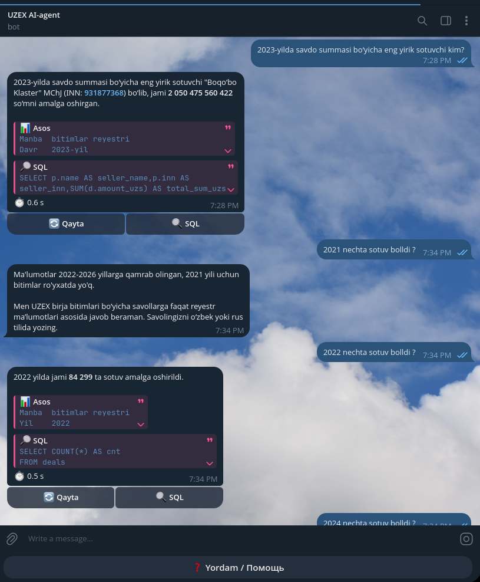
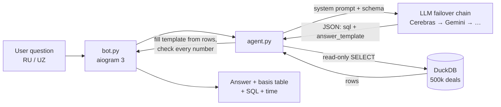

# UZEX Deals Agent: a text-to-SQL Telegram bot that does not make up answers

A Telegram bot that answers questions about commodity-exchange deals in **Russian and Uzbek (Latin and Cyrillic)**,
using **only** what a database query returns. If the data has no answer, it says so.

Built in about 3 hours for the selection round of the **UZEX AI Hackathon** (Uzbekistan Republican Commodity Exchange).
The rules: judges ask 10 unannounced questions, each answer must arrive within 90 s, and **one invented number, company
or product disqualifies the team**.

> Data: 500 000 fictional deals (2022–2026), 6 616 contracts, 14 392 companies, 120 brokers and daily USD rates,
> provided by the organizers. Everything is made up; see `uzex_spot_data/README.md` inside the zip.

<!-- Add a screenshot of the bot here:  -->

## Results

| | |
|---|---|
| Regression eval (`eval.py`, 18 judge-style questions, references computed by SQL) | **18 / 18** |
| Average answer time | **~2 s** (worst case under 30 s while LLM providers were rate-limited) |
| Languages | Russian, Uzbek Latin, Uzbek Cyrillic, with replies in the question's language |
| Questions with no data ("deals of OOO Roga i Kopyta", "deals in 2021", "coffee") | correctly answered as "no data" |

## How it works



1. **The LLM never writes the final numbers.** It returns a SQL query plus an `answer_template` such as
   `"In 2025 there were {cnt} cotton deals"`. Code runs the query and fills the placeholders from the result row.
2. **Number check:** if a number in an answer does not appear in any query result (or in the question), the model
   gets one retry with an error. An answer that contains numbers before any SQL has run is rejected outright.
3. **Entity check:** if the question names a company, broker, deal or product, the first query must confirm that it
   exists. If nothing matches, the model must return `not_found`; it may not reply "0 deals".
4. **Every answer shows its basis:** the filters used, a readable result table, the SQL and the time taken, in
   collapsible blocks in Telegram.

## Engineering highlights

- **Multilingual entity matching (`textnorm.py`):** one `norm()` function turns Russian Cyrillic, Uzbek Cyrillic and
  Uzbek Latin (with its four kinds of apostrophe) into a single Latin form, so `Go‘qe Prokat`, `Гўқе Прокат` and
  `goqe prokat` all match. It is registered as a DuckDB UDF.
- **Product families (`products.py`):** sellers typed 229 different product names. They map to 42 families with Uzbek
  aliases, so "paxta" finds raw cotton (Хлопок-сырец) and "AI-92" finds the right petrol.
- **LLM failover (`agent.py`):** up to 9 providers through any OpenAI-compatible or Anthropic API. It includes:
  - a circuit breaker (60 s after a 429 or timeout, 15 s after a 5xx), and providers with a bad key are switched off;
  - automatic fixes for 400 errors (drop `temperature`, rename `max_tokens`, drop reasoning effort);
  - a 60 s budget per question, with wait-and-retry while all providers are rate-limited.

  This kept free tiers usable: Cerebras allows only 5 requests per minute.
- **Safe SQL:** the connection is read-only, allows a single `SELECT`/`WITH` only, has external access disabled and
  the configuration locked, a 256 MB memory limit, a 10 s timeout via `con.interrupt()` and at most 50 rows.
- **Domain rules learned from evaluation:** "заключено/tuzilgan" means all deals; "исполнено" means both
  `Исполнен` and `Исполнен(Частично)`; "sold" excludes annulled deals; USD contracts are converted to UZS at the rate on
  the deal date.
- **Deployment:** systemd on a 2 GB Ubuntu VPS (`MemoryMax=600M`, `NoNewPrivileges`, `ProtectSystem`), plus a
  one-command `./deploy.sh` that pushes, pulls on the server, rebuilds only what changed and checks the bot came back.

## Files

| File | Role |
|---|---|
| `build_db.py` | CSV → `uzex.duckdb` (typed columns, USD→UZS, normalized names, product families) |
| `textnorm.py` | `norm()`: Cyrillic/Latin Uzbek + Russian → one Latin form |
| `products.py` | 229 product names → 42 families with Uzbek aliases |
| `agent.py` | LLM failover chain, safe SQL runner, agent loop, answer templates, number check |
| `bot.py` | aiogram 3 bot (long polling): answer, collapsible basis/SQL, retry button |
| `eval.py` | 18 judge-style questions with reference answers computed by SQL |
| `deploy/` | systemd unit + server-side update script |

## Run it

Requires Python 3.11+ and at least one LLM API key (Cerebras and Gemini both have free tiers).

```bash
python3 -m venv .venv && .venv/bin/pip install -r requirements.txt
unzip uzex_spot_data.zip && .venv/bin/python build_db.py uzex_spot_data uzex.duckdb
cp .env.example .env   # fill in BOT_TOKEN and at least one LLMn_API_KEY

.venv/bin/python agent.py --check-llm                                         # which providers work
.venv/bin/python agent.py "2025-yilda paxta bo‘yicha nechta bitim tuzilgan?"  # one question in the terminal
.venv/bin/python eval.py                                                      # regression test
.venv/bin/python bot.py                                                       # Telegram bot
```

`.env` values that contain JSON must be in single quotes (systemd strips double quotes).

Deploy: copy the app to `/opt/uzex-bot`, run as user `uzex`, install `deploy/uzex-bot.service`; later updates are
`./deploy.sh "message"` from your machine (put `root@SERVER_IP` into a `.vps` file).

## What I would do next

- Check the language of the model's own "no data" explanations (it sometimes answers a Russian question in Uzbek).
- Run the eval in CI against a pinned provider and track accuracy over time.
- Support conversation context ("and in 2024?") by passing the previous question's filters.
- Cache answers to repeated questions.

## Stack

Python · DuckDB · aiogram 3 · OpenAI-compatible APIs (Cerebras, Gemini, DeepSeek) and Anthropic · systemd

## License

MIT, see [LICENSE](LICENSE).
